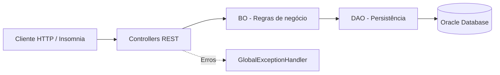

<div align="center">

# 🚆 Embarque Certo

### Informação para uma viagem mais previsível.

**API RESTful para consulta e gerenciamento de dados de mobilidade urbana, desenvolvida para a Global Solution 2026.2 da FIAP — CitizenTech.**


**[🌐 Acessar API publicada](https://gs-2-sem-java.onrender.com/api/health)** · **[📍 Consultar estações](https://gs-2-sem-java.onrender.com/api/estacoes)** · **[📖 Contrato REST](API-REST.md)**

</div>

---

## 💡 Sobre o projeto

Quem depende de **metrô, trem e outros transportes coletivos** precisa lidar com atrasos, estações cheias e dificuldades de acessibilidade — muitas vezes sem informações claras antes de sair de casa.

O **Embarque Certo** é uma proposta CitizenTech voltada a reunir informações sobre linhas, estações, ocorrências e lotação, facilitando o planejamento dos deslocamentos urbanos.

Nesta entrega, desenvolvemos o **back-end da solução**: uma API Java com persistência no Oracle da FIAP, regras de negócio, validação de dados e operações HTTP. Os registros de exemplo representam um cenário acadêmico; **não se trata de uma integração em tempo real com as operadoras**.

### O que a API oferece

- **Linhas:** consulta, cadastro, atualização e exclusão de linhas de transporte.
- **Estações:** gerenciamento de estações, localização e informações de acessibilidade.
- **Ocorrências:** registro e consulta de situações que afetam o deslocamento.
- **Lotação:** registro e consulta de níveis de ocupação informados para linhas e estações.
- **Validações e erros:** tratamento centralizado de dados inválidos, registros inexistentes e conflitos.

O domínio também modela **operadoras, usuários, tipos de ocorrência, vínculos entre linhas e estações, confirmações, trajetos e alertas**, oferecendo uma base para expansão futura.

## 🛠️ Tecnologias

| Tecnologia | Utilização |
|:--|:--|
| **Java 25** | Linguagem da aplicação |
| **Spring Boot 4.1.2** | Aplicação web e API REST |
| **Spring MVC** | Controllers e requisições HTTP |
| **Spring Data JPA / Hibernate** | Mapeamento e persistência de entidades |
| **Jakarta Validation** | Validação dos dados |
| **Oracle Database (FIAP)** | Armazenamento relacional |
| **Maven Wrapper** | Build e execução de testes |
| **Docker** | Empacotamento da aplicação |
| **Render** | Hospedagem pública da API |
| **IntelliJ IDEA / Insomnia** | Desenvolvimento e testes manuais |

## 🏗️ Arquitetura

Organizamos a aplicação em camadas, separando as requisições HTTP, as regras de negócio e o acesso ao banco de dados:



- **Model:** entidades JPA correspondentes às 11 tabelas do domínio, incluindo identificadores compostos.
- **DAO:** operações de acesso aos dados com `EntityManager`.
- **BO:** validações, regras de negócio e controle transacional.
- **Controller:** exposição dos endpoints REST e definição das respostas HTTP.
- **DTO:** contratos de entrada e saída para recursos com relacionamentos.
- **Exception:** tratamento centralizado das exceções da API.

<details>
<summary><strong>Ver organização dos principais diretórios</strong></summary>

```text
GS-2-sem-Java/
├── .mvn/wrapper/                  # Maven Wrapper
├── scripts/                       # Scripts SQL do projeto
├── src/
│   ├── main/
│   │   ├── java/br/com/fiap/embarqueCertoAPI/
│   │   │   ├── bo/               # Regras de negócio
│   │   │   ├── config/           # Configurações
│   │   │   ├── controller/       # Endpoints REST
│   │   │   ├── dao/              # Acesso ao Oracle
│   │   │   ├── dto/              # Objetos de transferência
│   │   │   ├── exception/        # Tratamento de erros
│   │   │   └── model/            # Entidades JPA
│   │   └── resources/
│   │       └── application.properties
│   └── test/                      # Testes automatizados
├── Dockerfile
├── pom.xml
├── mvnw
└── mvnw.cmd
```

</details>

## 🌐 Endpoints da API

**URL base (Render):** [`https://gs-2-sem-java.onrender.com`](https://gs-2-sem-java.onrender.com)

Cada um dos quatro recursos abaixo oferece **GET, POST, PUT e DELETE**:

| Recurso | Listar / Cadastrar | Buscar / Atualizar / Excluir por ID |
|:--|:--|:--|
| **Linhas** | `/api/linhas` | `/api/linhas/{id}` |
| **Estações** | `/api/estacoes` | `/api/estacoes/{id}` |
| **Ocorrências** | `/api/ocorrencias` | `/api/ocorrencias/{id}` |
| **Registros de lotação** | `/api/registros-lotacao` | `/api/registros-lotacao/{id}` |

| Método | Operação | Resposta de sucesso |
|:--|:--|:--|
| `GET /api/recurso` | Listar registros | `200 OK` |
| `GET /api/recurso/{id}` | Consultar um registro | `200 OK` |
| `POST /api/recurso` | Cadastrar | `201 Created` |
| `PUT /api/recurso/{id}` | Atualizar | `200 OK` |
| `DELETE /api/recurso/{id}` | Excluir | `204 No Content` |

**Verificação da aplicação:** [`GET /api/health`](https://gs-2-sem-java.onrender.com/api/health)

> Os nomes `recurso` e `{id}` representam os caminhos e identificadores de cada tabela acima. Para exemplos completos de JSON, consulte o [contrato da API](API-REST.md).

### Exemplo de consulta

```http
GET https://gs-2-sem-java.onrender.com/api/estacoes
```

Exemplo de objeto retornado:

```json
{
  "idEstacao": 1,
  "nmEstacao": "Luz",
  "nrLatitude": -23.5352,
  "nrLongitude": -46.6353,
  "nrMinBaldeacao": 6,
  "stAcessivel": "S"
}
```

As listagens retornam **arrays JSON**; o exemplo acima representa um item da lista de estações.

### Respostas de erro

O tratamento centralizado utiliza, entre outros, os seguintes códigos:

| HTTP | Significado |
|:--|:--|
| `400` | Dados inválidos ou regra de negócio não atendida |
| `404` | Registro não encontrado |
| `409` | Conflito ou violação de integridade |
| `500` | Erro interno inesperado |

## 🚀 Executando localmente

### Pré-requisitos

- **JDK 25** instalado e configurado.
- Acesso ao **Oracle Database da FIAP**, com as tabelas do projeto já disponíveis.
- **Git** para clonar o repositório.
- IntelliJ IDEA (opcional). O projeto inclui Maven Wrapper, portanto não exige instalação separada do Maven.

### 1. Clonar o projeto

```bash
git clone https://github.com/danielbritojunior/GS-2-sem-Java.git
cd GS-2-sem-Java
```

### 2. Configurar a conexão Oracle

A aplicação utiliza variáveis de ambiente. **Não inclua usuário, senha ou URL privada diretamente no código ou em commits.**

No **PowerShell (Windows)**, defina as variáveis na sessão do terminal:

```powershell
$env:DB_URL = "<URL_JDBC_DO_ORACLE_FIAP>"
$env:DB_USER = "<USUARIO_ORACLE>"
$env:DB_PASS = "<SENHA_ORACLE>"
```

As propriedades relevantes da aplicação são:

```properties
spring.datasource.url=${DB_URL}
spring.datasource.username=${DB_USER}
spring.datasource.password=${DB_PASS}
server.port=${PORT:8080}
```

> A conexão exige um banco já preparado. O repositório contém os scripts SQL em `scripts/`, mas os scripts de DDL/DML principais podem remover tabelas ou dados existentes. **Não execute esses scripts novamente em um esquema já preenchido.**

### 3. Iniciar a aplicação

No Windows:

```powershell
.\mvnw.cmd spring-boot:run
```

No Linux/macOS:

```bash
./mvnw spring-boot:run
```

Com a aplicação iniciada, acesse:

```text
http://localhost:8080/api/health
http://localhost:8080/api/estacoes
```

### 4. Compilar ou executar testes

```powershell
.\mvnw.cmd clean package
```

Para executar apenas a suíte de testes:

```powershell
.\mvnw.cmd test
```

O projeto teve **550 testes automatizados aprovados** durante a validação acadêmica. Os testes abrangem as camadas de domínio, persistência simulada, regras de negócio, Controllers e respostas HTTP.

## ☁️ Deploy

A API está publicada no **Render**, com build via Docker e variáveis de ambiente para conexão ao Oracle.

**[Acessar API pública](https://gs-2-sem-java.onrender.com/api/health)** · **[Consultar estações](https://gs-2-sem-java.onrender.com/api/estacoes)**

> Em instâncias gratuitas, a primeira requisição após um período de inatividade pode levar mais tempo para responder.

## 📚 Documentação técnica

Para consultar decisões e detalhes de implementação:

- [`API-REST.md`](API-REST.md) — endpoints, contratos JSON, validações e códigos HTTP.
- [`DAO-BO.md`](DAO-BO.md) — persistência, regras de negócio e testes.
- [`MODEL-JPA.md`](MODEL-JPA.md) — entidades e mapeamento JPA.
- [`DIAGNOSTICO-ORACLE.md`](DIAGNOSTICO-ORACLE.md) — diagnóstico da integração Oracle.

## 👨‍💻 Equipe

| Integrante | RM |
|:--|:--|
| **Daniel Brito dos Santos Junior** | 566236 |
| **Gustavo Palomares Borsato** | 564621 |
| **Vitor Rampazzi Franco** | 562270 |

---

<div align="center">

**FIAP · Engenharia de Software · Global Solution 2026.2**  
*CitizenTech — tecnologia aplicada aos desafios da cidade.*

</div>
